<div align="center">

  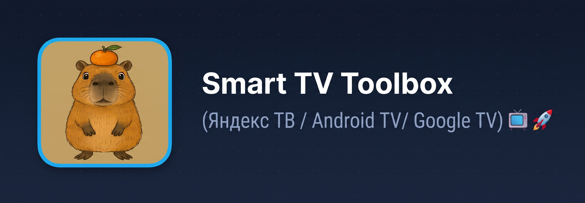

  <br/><br/>

  [](https://www.python.org/)
  [](https://android.com/tv/)
  [](https://yandex.ru/smart-tv)
  [](https://developer.android.com/tools/adb)
  [](LICENSE)
  [](https://github.com/pururuall/SmartTV-Toolbox/releases/latest)

  <br/><br/>

  <a href="https://github.com/pururuall/SmartTV-Toolbox/releases/latest">
    
  </a>
  &nbsp;&nbsp;
  <a href="#-пошаговая-инструкция-по-подключению-тв">
    
  </a>

</div>

> [!IMPORTANT]
> **Для запуска приложения скачивайте готовый `SmartTV_Control.exe` по зелёной кнопке выше или со страницы [GitHub Releases (v4.4.2)](https://github.com/pururuall/SmartTV-Toolbox/releases/latest).**  
> Скомпилированный бинарник (`~450 МБ`) со всеми встроенными зависимостями распространяется через официальные релизы GitHub, чтобы дерево исходного кода оставалось лёгким и чистым.

---

## 💡 О проекте

**Smart TV Toolbox** — комплекс инструментов и официальное графическое приложение **SmartTV_Control.exe** для глубокой оптимизации, очистки от рекламного мусора (debloat), тонкой визуальной настройки лаунчеров и обхода замедлений YouTube на телевизорах и ТВ-приставках под управлением Android 9–14:

* **Яндекс ТВ (YaOS / CVTE):** Tuvio, Hartens, DEXP, Novex, Hi и др.
* **Салют ТВ (StarOS / SberBox):** СберДевайсы, саундбары и приставки.
* **Haier / Candy:** MatrixTV, uSmart, Evo TV.
* **Xiaomi / Redmi:** PatchWall, TV Stick, Mi Box.
* **TCL / iFFALCON / Toshiba / Hisense / Sony:** Android TV и Google TV.

---

## 🏛️ Архитектура системы

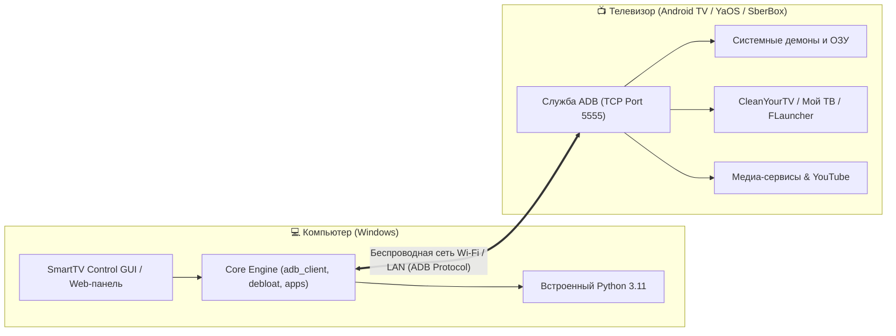

---

## 📁 Таблица структуры папок репозитория

| Директория / Файл | Назначение |
| :--- | :--- |
| **`core/`** | Модульное ядро: `adb_client.py`, `debloat.py`, `apps_installer.py`, `ui_bridge.py` |
| **`tv_manager.py`** | Фасад (Bridge) контроллера SmartTVManager для полной обратной совместимости |
| **`gui_app.py`** | Десктопный графический интерфейс управления на базе Tkinter |
| **`main_webview.py`** | Десктопное приложение на базе современного движка PyWebView (Microsoft WebView2) |
| **`server.py`** | Локальный веб-сервер (`127.0.0.1:8000`) с поддержкой WebSocket для веб-панели |
| **`app_ui.html`** | **Единый источник правды (SSOT)** интерактивного веб-интерфейса управления |
| **`apps/`** | Каталог проверенных APK-пакетов по категориям (`launchers/`, `media/`, `youtube/`) |
| **`web_remote/`** | Мобильный сенсорный пульт управления ТВ со смартфона по Wi-Fi |
| **`data/`** | Декларативные базы: `packages.json` (деблоат и стоп-листы), `launchers.json`, `known_devices.json` |
| **`wallpapers/`** | Встроенная галерея оптимизированных обоев для мгновенной доставки на ТВ |
| **`platform-tools/`** | Портативный набор утилит ADB от Google под Windows (не требует отдельной установки) |
| **`python-embed/`** | Автономный рантайм Python 3.11 для работы приложения без предварительной настройки системы |
| **`tests/`** | Набор автоматических тестов (`test_smoke.py`) для проверки целостности модулей |
| **`Запустить_SmartTV_Control.bat`** | Универсальный скрипт запуска (готовый EXE или интерпретатор Python) |

---

## 🚀 Что нового в версии 4.4.2

<details>
<summary><b>Развернуть список изменений v4.4.2 (CleanYourTV Live Sync, Action Circles & Factory Reset)</b></summary>
<br/>

### 1. 🎨 Мгновенная доставка тем и обоев на физический ТВ
- **Прямая синхронизация обоев:** CleanYourTV на физическом телевизоре считывает обои из системного слота. При выборе любых обоев («Dusk Peaks», «Aurora Borealis», «Golden Coast», «Dunes», «City Lights», «Mirror Lake») выбранное изображение немедленно транслируется на ТВ.
- **Полноценный режим Night OLED / OLED Guard:** Чистый чёрный цвет `#000000`, отключение фонового рисунка и защита матриц OLED от выгорания применяются на телевизоре в 1 клик.

### 2. 🔘 Управление кнопками-кружочками в шапке лаунчера
- **Готовые пресеты отображения:**
  - **«👁️ Вывести все»** — на экран выводятся все кнопки быстрого доступа: `[ ⇄ ]` (HDMI 1, HDMI 2, AV), `[ ⇅ ]` (Сортировка плиток), `[ ▦ ]` (Все установленные приложения), `[ 📶 ]` (Статус Wi-Fi сети), `[ 🛠️ ]` (Системные настройки Android TV), `[ ⚙️ ]` (Настройки лаунчера).
  - **«⚖️ Стандарт»** — лаконичный баланс: на экране остаются кнопки `[ ⇅ ]` и `[ ⚙️ ]`, остальные действия доступны при клике на шестеренку.
  - **«📦 Схлопнуть в шестеренку»** — чистый минимализм: все дополнительные кнопки убираются с экрана в выпадающее меню шестеренки.
- **Индивидуальные переключатели:** Возможность включить или выключить любую отдельную кнопку.
- **Динамическое меню шестеренки:** Все скрытые с экрана кнопки автоматически становятся пунктами быстрого запуска в меню `[ ⚙️ ]`.

### 3. ⚠️ Полный сброс лаунчера к заводским настройкам (Factory Reset)
- В панель синхронизации добавлена кнопка **«Сброс к заводским»**.
- По нажатию выполняется очистка хранилища (`pm clear com.gathin.tvhome`), повторное развёртывание заводского пакета обоев и перезапуск домашнего экрана.

### 4. 🔄 Исправление кнопок синхронизации и Drag-and-Drop Dock
- Интерактивное перетаскивание карточек приложений мышью для изменения порядка в Доке.
- Клик по плитке открывает модальное окно с выбором популярных ТВ-приложений (Zona, HDRezka, Spotify, VK Video, RuTube, SmartTube, Lampa, VLC и др.).
- После записи настроек приложение автоматически делает контрольный снимок экрана с ТВ для визуального подтверждения.

### 5. 📡 Выбор подключения при наличии нескольких ТВ
- Умный сканер локальной сети обнаруживает все устройства с открытым портом ADB (5555) и выводит список найденных ТВ с возможностью переключения в 1 клик.

</details>

---

## 📸 Скриншоты и демонстрация работы

<details open>
<summary><b>Развернуть галерею интерфейса Smart TV Toolbox и лаунчеров на ТВ</b></summary>
<br/>

### 🖥️ Интерфейс приложения Smart TV Toolbox v4.4.2

*(Полнофункциональный центр управления: 5 специализированных вкладок, интерактивный калькулятор ОЗУ и Live ADB-терминал)*

<br/>

<div align="center">
  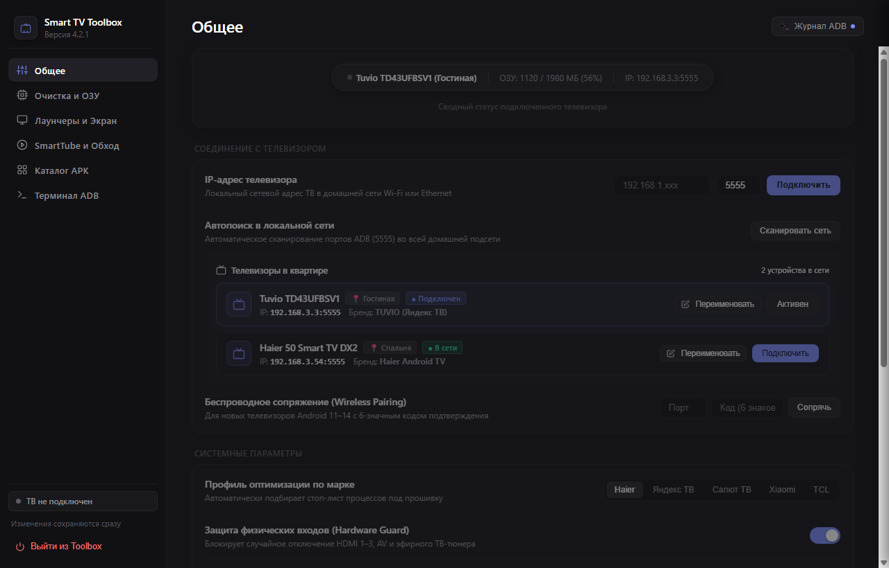
  <p><i>Вкладка 1: Умный автопоиск телевизоров в локальной сети, статус ADB и мониторинг свободной памяти</i></p>
  <br/>

  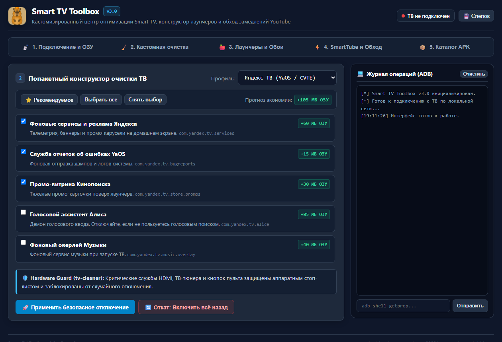
  <p><i>Вкладка 2: Конструктор очистки от мусора YaOS / SberBox / Haier с защитой от окирпичивания</i></p>
  <br/>

  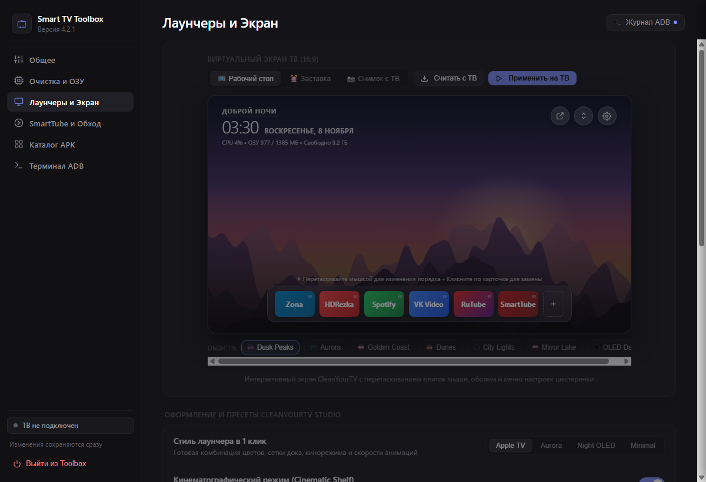
  <p><i>Вкладка 3: Визуальный редактор лаунчера CleanYourTV (Apple TV Style), обои и кнопки шапки</i></p>
  <br/>

  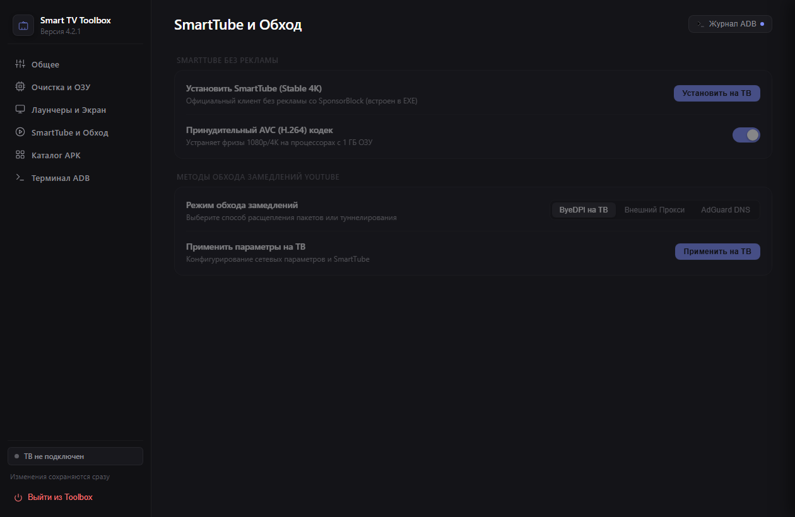
  <p><i>Вкладка 4: Установка SmartTube без рекламы и настройка обхода замедлений YouTube</i></p>
  <br/>

  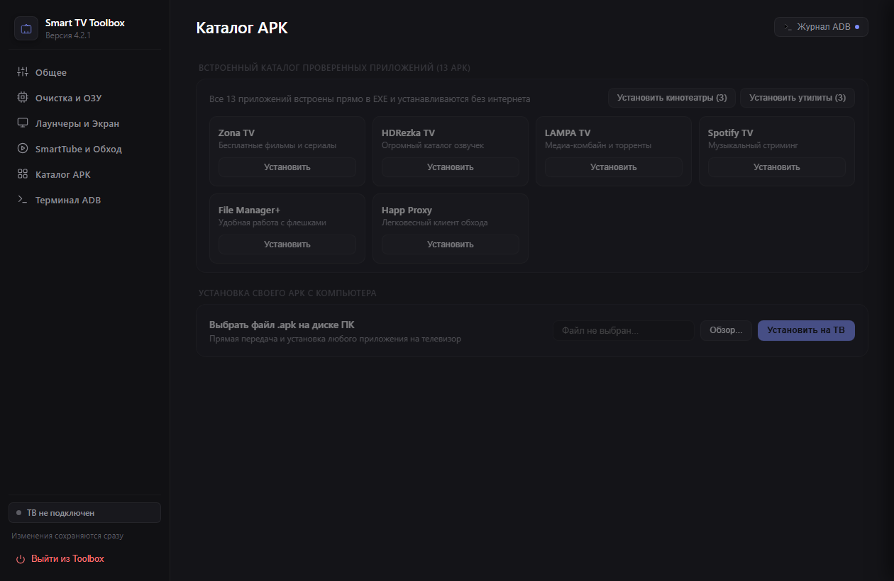
  <p><i>Вкладка 5: Пакетная установка проверенных медиа-приложений и интерактивная консоль ADB</i></p>
</div>

<br/>

### 📺 Лаунчеры на экране телевизора

<div align="center">
  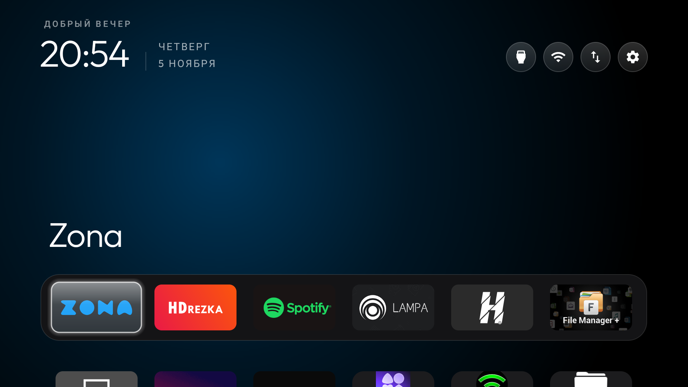
  <p><i>Лаунчер CleanYourTV (Apple TV Style): кинематографическая полка, стеклянный док и чистый минимализм</i></p>
  <br/>

  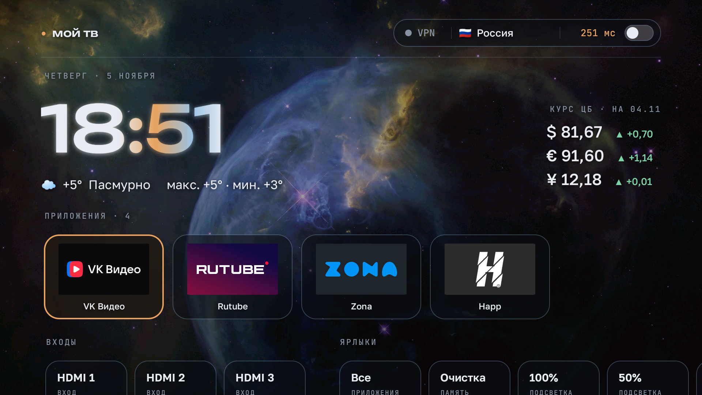
  <p><i>Лаунчер «Мой ТВ» (Moy-TV): современный плиточный интерфейс, оптимизированный под ТВ-пульты</i></p>
  <br/>

  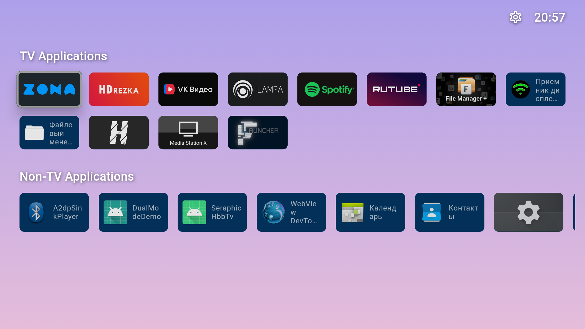
  <p><i>Лаунчер FLauncher: ультралёгкий Open-Source лаунчер с настраиваемыми категориями</i></p>
  <br/>

  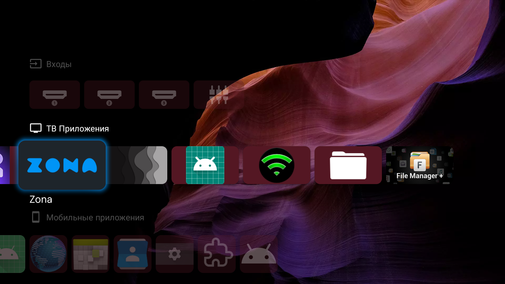
  <p><i>Лаунчер Projectivy Launcher: премиальный дизайн с поддержкой динамических каналов</i></p>
</div>

</details>

---

## 🧭 Архитектура и функционал приложения (5 вкладок)

<details>
<summary><b>Развернуть подробное описание всех 5 вкладок</b></summary>
<br/>

### 1. 📡 Вкладка 1: Подключение, беспроводное сопряжение и ОЗУ
- **Умный автопоиск телевизоров:** Многопоточное сканирование локальной подсети с обнаружением открытого порта ADB (5555).
- **Ручной ввод IP:** Прямое подключение к любому стационарному IP или порту (включая порты беспроводной отладки Android 11+).
- **Диагностика ОЗУ:** Снятие реальных показателей потребления памяти (MemTotal, MemFree, Cached, Buffers) и наглядный прогресс-бар загрузки.
- **Live-скриншот:** Мгновенный снимок текущего экрана телевизора с возможностью зума и обновления по кнопке.

### 2. 🧹 Вкладка 2: Попакетный конструктор очистки
- **Безопасный деблоат:** Отключение тяжелых фоновых демонов, рекламных промо-баннеров и телеметрии вендоров без риска окирпичивания.
- **Встроенные стоп-листы:** Критически важные системные модули (HDMI-входы, драйверы ТВ-тюнера, Bluetooth-пульт) аппаратно заблокированы от случайного удаления.
- **Пресеты в 1 клик:**
  - *Экспресс-очистка ОЗУ и кэша ТВ* — мгновенное освобождение оперативной памяти.
  - *Очистить службы Яндекс ТВ (-1.2 ГБ ОЗУ)* — отключение Алисы, AppMetrica и тяжелых промо-витрин.

### 3. 🍎 Вкладка 3: Лаунчеры и Обои прямо с ПК
- **CleanYourTV Studio:** Настройка сетки и колонок, стеклянная подложка дока, кинематографическая верхняя полка, точки пагинации и свечение Ambient Glow.
- **Кнопки шапки (Action Circles):** Управление кружочками быстрого меню (Wi-Fi, сортировка, HDMI/AV входы, библиотека).
- **Галерея 4K/FHD обоев:** Выбор из встроенной коллекции с мгновенной отправкой файла на телевизор через ADB.
- **Альтернативные лаунчеры:** Установка и автонастройка «Мой ТВ», FLauncher, Projectivy Launcher.

### 4. ⚡ Вкладка 4: SmartTube и обход замедлений YouTube
- **SmartTube Stable:** Установка актуального клиента YouTube без рекламы, со SponsorBlock и поддержкой 4K HDR.
- **AVC/H.264 кодек:** Автоматическая преднастройка кодека и размера буфера для плавного воспроизведения на бюджетных ТВ (1 ГБ ОЗУ).
- **Обход замедлений:**
  - *ByeDPI на ТВ* — запуск локального прокси со сплитом пакетов (`--split 1+s --disorder 3 --ttl 5`).
  - *Внешний SOCKS5/HTTP прокси.*
  - *AdGuard Private DNS* — системная фильтрация рекламы на уровне ОС Android.

### 5. 📦 Вкладка 5: Каталог APK и Live ADB консоль
- **Пакетная установка проверенного софта:** Zona TV, HDRezka TV, LAMPA, SmartTube, File Manager+, Happ Proxy, Spotify TV, ByeDPI TV.
- **Интерактивный терминал ADB:** Живой журнал выполнения команд и строка прямого ввода пользовательских команд.

</details>

---

## 📖 Пошаговая инструкция по подключению ТВ

### Шаг 1. Включение отладки по ADB на телевизоре

* **Яндекс ТВ / YaOS / CVTE (Tuvio, Hartens, DEXP, Novex, Hi):**
  1. Зажмите кнопку **Menu** (или кнопку «Шестеренка / Настройки») на пульте на 1–2 секунды.
  2. Быстро нажмите стрелками на пульте: `Влево ➔ Вверх ➔ Влево ➔ Вверх` и нажмите кнопку **Назад**.
  3. В открывшемся сервисном меню Factory перейдите в раздел `other options` (или `Design / Function`).
  4. Установите параметр **`ADB: ON`** (если присутствует пункт `USB Mode` — выберите **`Device`**).
* **Салют ТВ / StarOS / SberBox:**
  1. Откройте `Настройки` ➔ `Система` ➔ `Об устройстве`.
  2. Нажмите кнопку **OK 7 раз подряд на пункте «Номер сборки»** до появления уведомления *«Вы стали разработчиком»*.
  3. Вернитесь в `Настройки разработчика` и включите пункт **«Отладка по ADB»**.
* **Android TV / Google TV (Haier, Xiaomi, TCL, Hisense, Sony):**
  1. Откройте `Настройки` ➔ `Настройки устройства` (или `Система` ➔ `Об устройстве`).
  2. Нажмите **OK 7 раз на пункте «Номер сборки»**.
  3. В появившемся меню `Для разработчиков` включите **«Отладка по USB»** (или Wireless Debugging).
  * *Для телевизоров Toshiba (REGZA / Android TV):* Сервисное меню вызывается кнопкой `Input / Source` ➔ ввод кода `3195` (или `Menu` ➔ `1 1 4 7`).

### Шаг 2. Подключение через SmartTV Control

1. Убедитесь, что компьютер и телевизор подключены к одной локальной сети (одному Wi-Fi роутеру).
2. Запустите **`SmartTV_Control.exe`** (или скрипт `Запустить_SmartTV_Control.bat`).
3. Введите IP-адрес телевизора (или нажмите кнопку **«🔍 Автопоиск ТВ»**) и нажмите **«📡 Подключиться»**.
4. **Важно:** При первом подключении на экране телевизора появится системный диалог:  
   *«Разрешить отладку по USB с этого компьютера?»*.  
   Поставьте галочку **«Всегда разрешать с этого компьютера»** и нажмите **«Разрешить / OK»**.
5. После успешного подключения выберите профиль деблоата, активируйте лаунчер или установите нужные медиа-приложения!

---

## 🛠️ Запуск из исходного кода для разработчиков

Если вы хотите запускать проект из исходного кода или вносить изменения:

```bash
# 1. Клонирование репозитория
git clone https://github.com/pururuall/SmartTV-Toolbox.git
cd SmartTV-Toolbox

# 2. Запуск через встроенный Python
.\python-embed\python.exe gui_app.py

# 3. Или запуск через универсальный скрипт
.\Запустить_SmartTV_Control.bat
```

Для сборки исполняемого файла в директорию `dist/`:
```bash
.\python-embed\python.exe -m PyInstaller SmartTV_Control.spec
```

---

<div align="center">

  Разработано с заботой о скорости и комфорте просмотра умного ТВ ❤️

  [](https://github.com/pururuall/SmartTV-Toolbox)
  [](https://github.com/pururuall/SmartTV-Toolbox)

</div>
