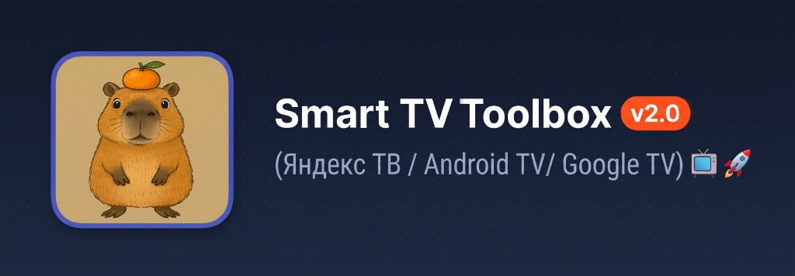
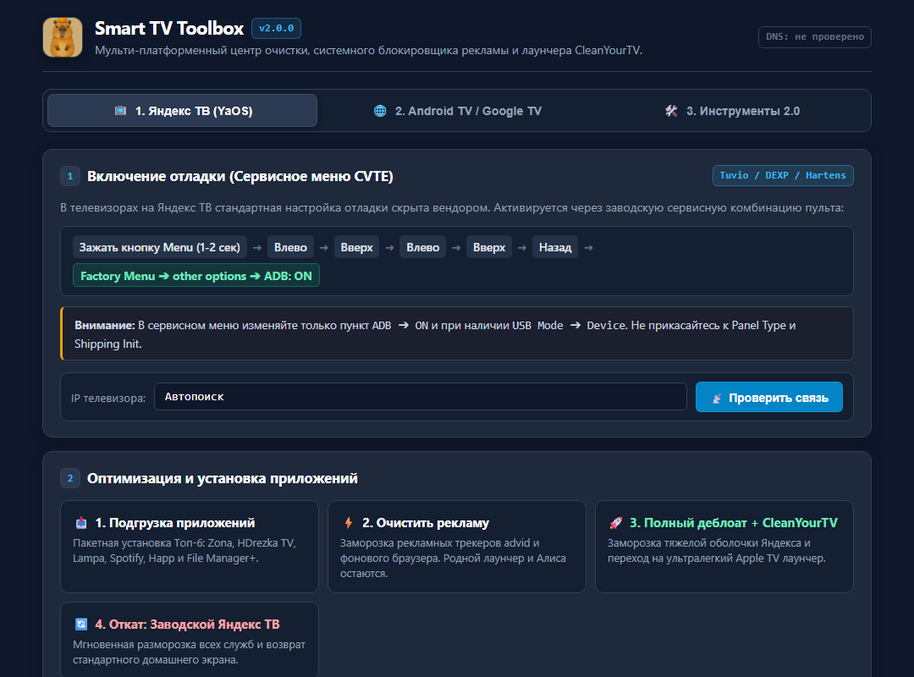

  

[-3b82f6?style=for-the-badge&logo=github&logoColor=white)](https://github.com/pururuall/SmartTV-Toolbox/archive/refs/heads/main.zip)

 

### 🍊 [👉 НАЖМИТЕ ЗДЕСЬ, ЧТОБЫ СКАЧАТЬ ПОСЛЕДНЮЮ ВЕРСИЮ SmartTV_Control.exe (v2.0.0) 👈](https://github.com/pururuall/SmartTV-Toolbox/releases/latest/download/SmartTV_Control.exe)

*(Автономная программа с нативным интерфейсом и иконкой капибары. Не требует установки Python или ADB. Ссылка всегда загружает самый свежий релиз)*

---

Комплект скриптов, утилит и официальное приложение **SmartTV_Control.exe** (версия **2.0.0**) для ускорения, очистки от рекламы, безопасного деблоата и прокачки любых Smart TV на базе Android 9–14: как с оболочкой **Яндекс ТВ (YaOS)** (Tuvio, Hartens, DEXP, Novex, Hi и др.), так и стандартных **Android TV / Google TV** (Haier, Xiaomi, TCL, Sony Bravia, Hisense, realme, Chromecast).

---

## 📸 Скриншоты и демонстрация работы

### 🖥️ Интерфейс приложения Smart TV Toolbox v2.0
*(Светло-сланцевая тема, вкладки под разные ТВ, интерактивный выбор брендов и живой лог)*

  

### 📺 Телевизор после оптимизации и установки лаунчера CleanYourTV
*(Ультралегкий домашний экран в стиле Apple TV с настроенным доком Топ-6 приложений и нулевой рекламой)*

---

## 🌟 Что нового в версии 2.0.0

- 📑 **Вкладочная система интерфейса:**
  - **Вкладка 1: 📺 Яндекс ТВ (YaOS / Tuvio)** — инструкция к сервисному меню CVTE (`Menu -> Влево -> Вверх -> Влево -> Вверх -> Назад`), автопоиск ТВ по mDNS/порт 5555, деблоат Яндекс ТВ и восстановление.
  - **Вкладка 2: 🌐 Android TV & Google TV** — интерактивная шпаргалка с кликабельным выбором брендов: **Haier**, **Xiaomi / Redmi**, **TCL / iFFALCON**, **Sony Bravia / Philips**, **Chromecast / Google TV**, **Hisense**. Выбор бренда мгновенно выводит точный путь в меню и специфику настройки до проверки связи.
  - **Вкладка 3: 🛠️ Инструменты 2.0** — системная блокировка рекламы AdGuard DNS, ультралегкий Apple TV лаунчер CleanYourTV, динамический редактор нижнего дока и установка сторонних APK.
- 🏢 **Полная поддержка телевизоров Haier (MatrixTV / Smart TV BX / H-серия):**
  - Подробная инструкция вызова настроек разработчика на пультах Haier.
  - Очистка вендорских промо-служб Haier: `com.haierubic.usmartdevice` (IoT), `com.haier.oemtabprovider` (рекламная вкладка), `com.haier.tvhousekeeper` (телеметрия) и промо-лаунчера `haiermatrix`.
- 🍎 **Динамический редактор дока CleanYourTV (4–8 слотов):**
  - При выборе количества колонок (4, 5, 6, 7, 8) список слотов автоматически добавляет или убирает строки в реальном времени.
  - Возможность назначать в каждый слот приложения из каталога, либо загружать список установленных на ТВ приложений в 1 клик, либо вводить свои имена пакетов.
- 🛡️ **Системная блокировка рекламы (AdGuard Private DNS в 1 клик):**
  - Блокирует баннеры, видеорекламу и трекеры во всех приложениях (Zona, Lampa, браузеры, домашний экран) на уровне ОС Android.
  - Не требует установки сторонних фоновых VPN-приложений, не расходует оперативную память ТВ и не режет скорость интернета.
- 🍎 **Ультралегкий лаунчер CleanYourTV (Apple TV Style):**
  - Размер APK всего ~500 КБ. Запускается мгновенно, работает плавно даже на самых слабых процессорах (1 ГБ ОЗУ).
  - **Визуальный редактор дока:** возможность менять порядок приложений нижней панели (Zona, HDrezka, Lampa, Spotify, Happ, File Manager+) кнопками ▲ / ▼ и настраивать количество колонок (4–8).
- 📥 **Подгрузка Топ-6 приложений для ТВ:**
  - Быстрая установка проверенного набора: Zona, HDrezka TV, LAMPA, Spotify TV, Happ (прокси-утилита) и File Manager+.
- 🔄 **100% обратимость и безопасность:**
  - Деблоат выполняется через `pm disable-user --user 0`, без удаления системных APK и без риска «окирпичивания».
  - Функция «Откат: Восстановить систему» в 1 клик возвращает заводские службы и оригинальный домашний экран.

---

## 🛠️ Содержимое репозитория

| Файл / Папка | Назначение |
|---|---|
| **`SmartTV_Control.exe`** | 🚀 **Главное приложение (v2.0.0):** графическая панель со вкладками, логотипом, редактором дока, переключателем DNS и логом |
| `START_HERE.html` | 📖 Интерактивное руководство с веб-интерфейсом и шпаргалкой |
| `Instruction.html` | 📖 Автономная копия интерактивной панели |
| `tv_manager.py` | ⚙️ Универсальный Python-модуль управления ТВ по ADB |
| `main_webview.py` | 🖥️ Исходный код графического интерфейса WebView2 |
| `server.py` | 🌐 Локальный HTTP-сервер для работы через любой браузер |
| `gui_app.py` | 🪟 Альтернативный легковесный интерфейс на Tkinter |
| `apps/` | APK-пакеты проверенных приложений под Android TV (отслеживаются через Git LFS) |
| `platform-tools/` | Официальные утилиты ADB от Google под Windows |
| `img/` | Баннер и скриншоты приложения и настроенного ТВ |

---

## 📖 Инструкция по быстрому запуску

### Вариант 1. Телевизор на Яндекс ТВ (Tuvio, DEXP, Hartens, Novex, Hi):
1. Зажмите кнопку **Menu** (три полоски) на пульте на 1–2 секунды.
2. Быстро нажмите стрелки: `Влево ➔ Вверх ➔ Влево ➔ Вверх`.
3. Нажмите кнопку **Назад**.
4. В синем меню **Factory menu** перейдите в `other options`.
5. Переключите пункт **`ADB`** в положение **`ON`**. Если есть `USB Mode` — переведите в **`Device`**.

### Вариант 2. Телевизоры на Android TV и Google TV (Haier, Xiaomi, TCL, Sony, Hisense, Chromecast):
1. Откройте `Настройки` ➔ `Настройки устройства` (или `Система`) ➔ `Об устройстве`.
2. Найдите строку **«Номер сборки»** (или «Сборка ОС Android TV») и быстро нажмите кнопку **OK на пульте 7 раз подряд** до появления сообщения *«Вы стали разработчиком!»*.
3. Вернитесь назад в меню `Для разработчиков` и включите **«Отладка по USB»** (USB debugging).
4. Узнайте IP телевизора в `Настройки` ➔ `Сеть и Интернет` ➔ имя вашей Wi-Fi сети ➔ `IP-адрес`.

### 🚀 Запуск программы:
1. Запустите **`SmartTV_Control.exe`**.
2. Введите IP (или оставьте «Автопоиск») и нажмите **«📡 Проверить соединение»**.
3. При первом подключении на экране ТВ появится системный запрос *«Разрешить отладку по USB?»* — обязательно поставьте галочку **«Всегда разрешать с этого компьютера»** и нажмите **ОК** пультом.
4. Выберите нужную операцию (подгрузка приложений, оптимизация, переключение DNS или настройка дока CleanYourTV).
