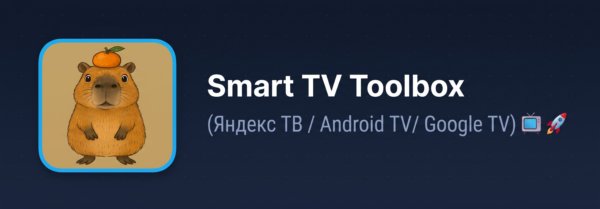
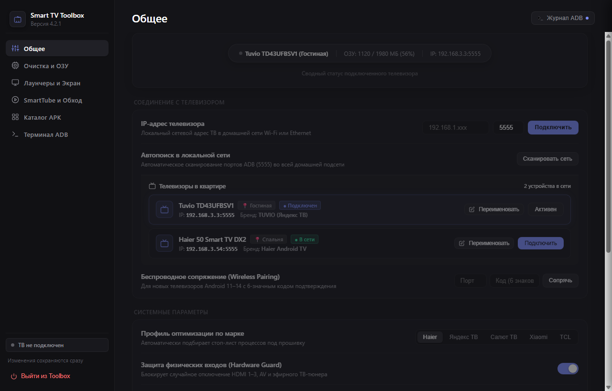
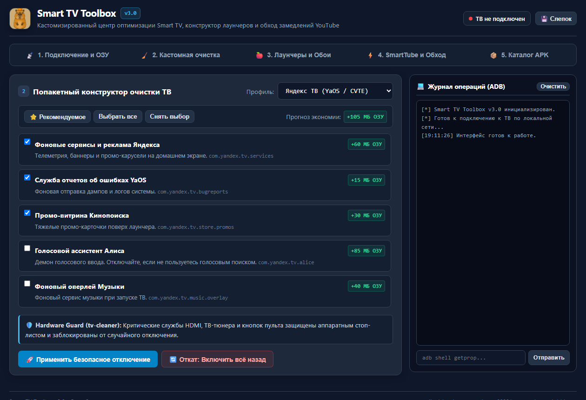
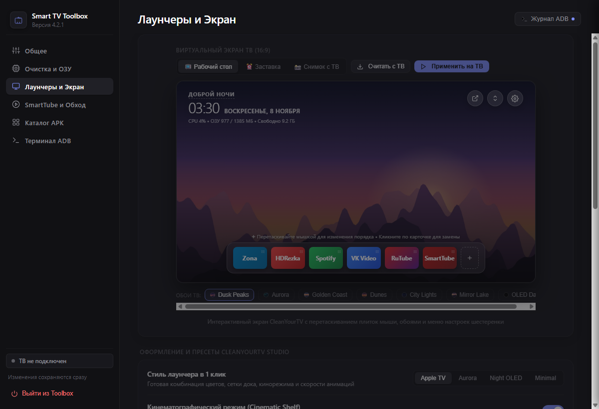
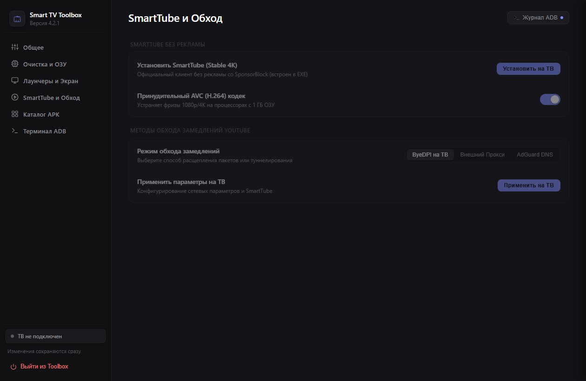
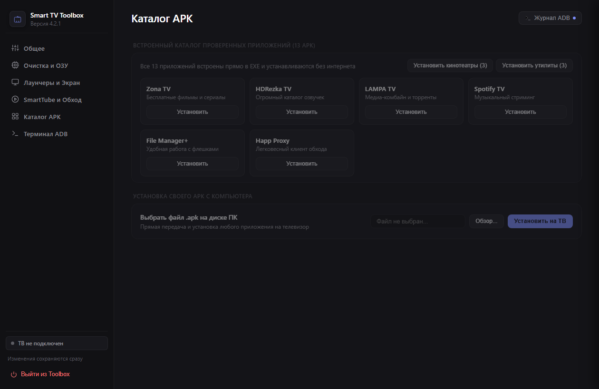
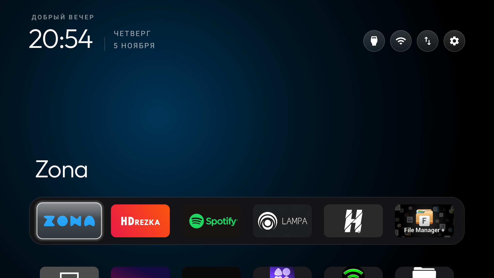
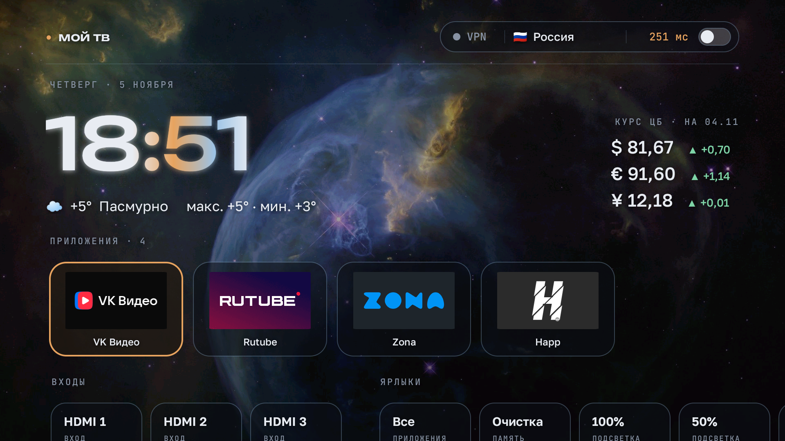
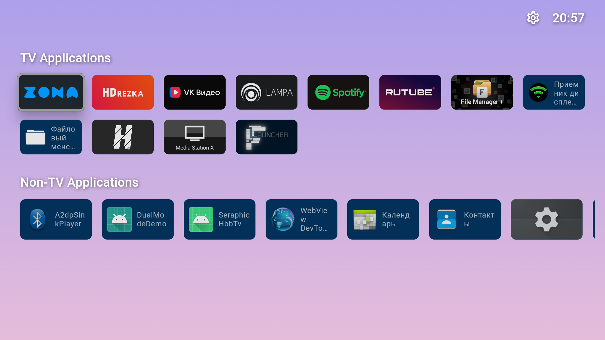
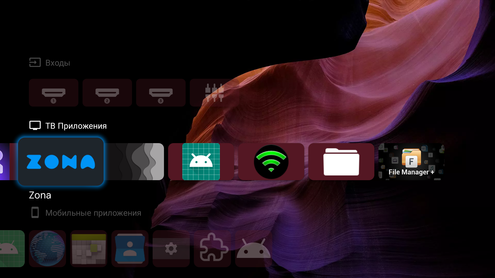

  

    

  
  
  

---

Комплект скриптов, утилит и официальное приложение **SmartTV_Control.exe** (версия **4.0.0**) для глубокой очистки, ускорения, тонкой настройки лаунчеров, управления процессами в реальном времени и обхода замедлений YouTube на любых Smart TV под управлением Android 9–14: **Яндекс ТВ (YaOS / CVTE)** (Tuvio, Hartens, DEXP, Novex, Hi), **Салют ТВ (StarOS / SberBox)**, **Haier** (MatrixTV / uSmart), **Xiaomi / Redmi** (PatchWall), **TCL / iFFALCON** и стандартных **Android TV / Google TV**.

---

## 🚀 Что нового в версии 4.0.0 (Live Process Manager & Full Offline Bundle)

### 1. ⚡ Диспетчер процессов и ОЗУ в реальном времени (Tab 2 «Очистка ТВ»)
- **Живое сканирование памяти через ADB (`dumpsys meminfo` / `ps`):** Одно нажатие кнопки «⚡ Сканировать процессы в ОЗУ» анализирует все работающие в данный момент приложения и системные демоны.
- **Точный замер памяти в МБ:** Отображение реального потребления ОЗУ для каждого процесса и сводный счетчик: сколько всего ОЗУ занято и сколько МБ можно безопасно вернуть системе.
- **Человеческие описания для ВСЕХ процессов:** 76+ детализированных описаний на русском языке не только системных демонов, но и установленных пользовательских стримингов (ВК Видео, Кинопоиск, Иви, Wink, Premier, OKKO, KION, Zona, Lampa, SmartTube, HDRezka, Telegram и др.).
- **Цветовая классификация безопасности:**
  - 🟢 **Безопасно (Не влияет на систему):** фоновые промо-демоны вендоров (Haier `usmartdevice`, `oemtabprovider`, `tvhousekeeper`), магазины приложений и тяжелые пользовательские стриминги, висящие в фоне.
  - 🟡 **Внимание / Опционально (Влияет на доп. функции):** Google Play Services, штатные лаунчеры вендоров, трансляция экрана Miracast/Cast.
  - 🔴 **Критический модуль (Аппаратная часть ТВ):** HDMI/AV видеовходы, эфирный ТВ-тюнер, системные настройки шасси. Чекбоксы аппаратно заблокированы от случайной остановки.
- **Управление процессами на лету:**
  - **«⏹️ Выгрузить из ОЗУ сейчас» (`am force-stop`):** мгновенно освобождает десятки и сотни мегабайт памяти без перезагрузки ТВ.
  - **«❄️ Заморозить навсегда» (`pm disable-user --user 0`):** отключает автозапуск процесса даже после перезагрузки телевизора.
  - **«▶️ Разморозить» (`pm enable`):** возвращает процесс к нормальной работе в 1 клик.
- **Интерактивные фильтры:** быстрое переключение между категориями «Все», «Безопасно», «Внимание», «Сторонние приложения», «Замороженные».

### 2. 📦 Полный автономный пакет (Все 13 APK встроены в EXE)
- Все приложения каталога (CleanYourTV, MoyTV, FLauncher, Projectivy, Lampa, Zona, HDRezka, FileManagerPlus, Happ, SpotifyTV, SmartTube, ByeDPI, TVWebRemote) теперь запакованы прямо внутрь `SmartTV_Control.exe`.
- Установка лаунчеров и приложений работает полностью автономно без необходимости скачивания файлов из интернета и без ошибок «Файл APK не найден».

### 3. 📺 Расширенная оптимизация для телевизоров Haier
- База пакетов дополнена 12 специализированными службами Haier Matrix / uSmart (фоновые сборщики логов, промо-вкладки, магазины, автоапдейтеры) с защитой физических HDMI и ТВ-тюнеров.

---

---

## 📸 Скриншоты и демонстрация работы

### 🖥️ Интерфейс приложения Smart TV Toolbox v3.0

*(Полнофункциональный центр управления: 5 специализированных вкладок, интерактивный калькулятор ОЗУ и Live ADB-терминал)*

 

<b>📡 Вкладка 1: Подключение, беспроводное сопряжение и диагностика ОЗУ</b>

 

 

<b>🧹 Вкладка 2: Попакетный конструктор очистки (Debloat) с защитой Hardware Guard</b>

 

 

<b>🍎 Вкладка 3: Лаунчеры (CleanYourTV / Мой ТВ / Projectivy / FLauncher) и Галерея Обоев</b>

 

 

<b>⚡ Вкладка 4: SmartTube без рекламы и обход замедлений (ByeDPI / Прокси / DNS)</b>

 

 

<b>📦 Вкладка 5: Каталог медиа-приложений APK и Live ADB консоль</b>

 

  

### 📺 1. Лаунчер CleanYourTV (Apple TV Style) на ТВ
*(Ультралегкий домашний экран ~500 КБ с настраиваемым доком Топ-6 приложений и нулевой рекламой)*

  

### 📺 2. Лаунчер «Мой ТВ» (Moy-TV) на ТВ
*(Информационный дашборд с виджетами погоды, курсов валют ЦБ РФ, новостей, ярлыками HDMI 1–3 и веб-пультом)*

  

### 📺 3. Лаунчер FLauncher на ТВ
*(Классический Open-Source лаунчер под Android TV с настраиваемыми категориями и сеткой)*

  

### 📺 4. Лаунчер Projectivy Launcher на ТВ
*(Премиальный современный интерфейс: динамические каналы рекомендаций, быстрое переключение входов HDMI 1–3, калибровка дисплея и нулевая реклама)*

---

## 🌟 Что нового в версии 3.0.0 (Custom-First)

Проект полностью модернизирован и объединил базы знаний и архитектурные решения из четырёх профильных экосистем: **SmartTV-Toolbox**, **[Jipok/tv-cleaner](https://github.com/Jipok/tv-cleaner)**, **[andrewm8888/moy-tv](https://github.com/andrewm8888/moy-tv)** и **[by-sonic/chistytv](https://github.com/by-sonic/chistytv)**.

### 1. 📡 Вкладка 1: Подключение, беспроводное сопряжение и ОЗУ
- **Автоопределение шасси:** Система считывает вендора, модель, версию Android и рекомендуемый профиль очистки.
- **Диагностика RAM и ZRAM:** Анализ реальной загрузки ОЗУ и swap через `dumpsys meminfo` до и после оптимизации.
- **Wireless Pairing (Android 11–14):** Быстрое сопряжение по 6-значному коду и порту без проводов.

### 2. 🧹 Вкладка 2: Попакетный конструктор очистки
- **Выбор профилей по брендам:** Яндекс ТВ (YaOS), Салют ТВ, Haier, Toshiba (REGZA / Android TV), Xiaomi, TCL, Google TV.
- **Калькулятор ОЗУ:** Динамический подсчет освобождаемой оперативной памяти (в МБ) перед применением деблоата.
- **Hardware Guard (tv-cleaner):** Критические службы HDMI, ТВ-тюнера и кнопок пульта защищены аппаратным стоп-листом и заблокированы от случайного отключения.
- **100% обратимость:** Автоматический слепок состояния перед отключением и кнопка «Откат: Включить всё назад» в 1 клик.

### 3. 🍎 Вкладка 3: Лаунчеры и Обои прямо с ПК
- **Наглядное сравнение потребления памяти лаунчерами:**
  - **CleanYourTV:** ⚡ `~15–25 МБ ОЗУ` • `~500 КБ диска` — ультралегкий минимализм Apple TV, круглые иконки верхнего меню `[ 🔌 ] [ 📶 ] [ ⇅ ] [ ⚙️ ]`.
  - **FLauncher:** 🍃 `~45–60 МБ ОЗУ` • `~26 МБ диска` — быстрый классический Open-Source лаунчер с категориями и сеткой.
  - **Мой ТВ (Moy-TV):** 📊 `~50–70 МБ ОЗУ` • `~20 МБ диска` — информационный дашборд (погода, новости, курс ЦБ, ярлыки HDMI 1–3).
  - **Projectivy Launcher:** 🎬 `~65–95 МБ ОЗУ` • `~10 МБ диска` — премиум-оболочка с динамическими каналами и эффектами.
  - *(Для сравнения: заводской YaOS / Google TV лаунчер занимает от `180 до 350+ МБ ОЗУ`!)*
- **Автономный Web-пульт (порт 8080):** Опциональный встроенный микросервис (~36 КБ ОЗУ) для управления ТВ со смартфона через браузер; включается и отключается удобным чекбоксом в приложении.
- **Встроенная галерея обоев:** Готовая подборка ТВ-обоев высокого разрешения (1080p / 4K) и прямая загрузка любых изображений с ПК в память лаунчера на ТВ.

### 4. ⚡ Вкладка 4: SmartTube и обход замедлений YouTube
- **SmartTube Stable:** Установка актуального клиента YouTube без рекламы, со SponsorBlock и поддержкой 4K HDR.
- **Принудительный AVC/H.264 кодек:** Автоматическая преднастройка кодека и размера буфера для плавного воспроизведения на слабых процессорах (1 ГБ ОЗУ).
- **Гибкие методы обхода замедлений:**
  - **ByeDPI на ТВ:** Запуск локального прокси со сплитом пакетов (`--split 1+s --disorder 3 --ttl 5` и др.).
  - **Внешний SOCKS5/HTTP прокси.**
  - **AdGuard Private DNS:** Системная блокировка рекламы на уровне ОС Android без сторонних VPN.

### 5. 📦 Вкладка 5: Каталог APK и Live ADB консоль
- **Пакетная установка проверенного софта:** Zona TV, HDRezka TV, LAMPA, SmartTube, File Manager+, Happ Proxy, Spotify TV, ByeDPI TV.
- **Интерактивный терминал ADB:** Правая колонка с живым журналом выполнения команд и строкой прямого ввода для опытных пользователей.

---

## 🛠️ Содержимое репозитория

| Файл / Папка | Назначение |
|---|---|
| **`SmartTV_Control.exe`** | 🚀 **Главное приложение (v3.0.0):** 5-вкладочная панель, конструктор лаунчеров, Live ADB консоль |
| `data/packages.json` | 📋 Единая декларативная база пакетов по брендам со стоп-листами (tv-cleaner + chistytv) |
| `data/launchers.json` | 🍎 Метаданные лаунчеров (Moy-TV, CleanYourTV, Projectivy, FLauncher) и пути к конфигам |
| `wallpapers/` | 🖼️ Встроенная коллекция оптимизированных обоев для ТВ |
| `apps/` | 📦 Структурированный каталог APK (лаунчеры, youtube, медиа) |
| `START_HERE.html` | 📖 Интерактивный веб-интерфейс (автономный запуск в браузере) |
| `Instruction.html` | 📖 Автономная копия интерактивной панели |
| `tv_manager.py` | ⚙️ Единый контроллер SmartTVManager (ADB, диагностика ОЗУ, деблоат, YouTube) |
| `main_webview.py` | 🖥️ Нативный графический интерфейс на WebView2 |
| `server.py` | 🌐 Локальный HTTP-сервер (строго `127.0.0.1`) для запуска через браузер |
| `platform-tools/` | Официальные утилиты ADB от Google под Windows |
| `img/` | Баннеры и скриншоты приложения и всех поддерживаемых лаунчеров |

---

## 📖 Инструкция по быстрому запуску

### Включение отладки по сети:
1. **Яндекс ТВ / CVTE (Tuvio, Hartens, DEXP, Novex):** Зажмите кнопку **Menu** (1–2 сек) ➔ быстро нажмите: `Влево ➔ Вверх ➔ Влево ➔ Вверх` ➔ кнопка **Назад** ➔ в меню Factory перейдите в `other options` ➔ установите **`ADB: ON`** (если есть `USB Mode` — выберите **`Device`**).
2. **Android TV / Google TV (Haier, Toshiba, Xiaomi, TCL, Sony, Hisense):** Откройте `Настройки` ➔ `Настройки устройства` (или `Об устройстве`) ➔ нажмите **OK 7 раз на пункте «Номер сборки»** ➔ вернитесь в меню `Для разработчиков` ➔ включите **«Отладка по USB»** (или Wireless Debugging).
   - *Для Toshiba (REGZA / Android TV):* Сервисное меню вызывается кнопкой `Input / Source` ➔ код `3195` (или `Menu` ➔ `1 1 4 7`).

### Запуск программы:
1. Запустите **`SmartTV_Control.exe`**.
2. Введите IP телевизора (или нажмите «🔍 Автопоиск ТВ») и нажмите **«📡 Подключиться»**.
3. При первом подключении на экране телевизора подтвердите запрос *«Разрешить отладку по USB?»* (поставьте галочку *«Всегда разрешать с этого компьютера»*).
4. Переходите между вкладками для диагностики ОЗУ, отключения рекламы, настройки лаунчеров и SmartTube!
